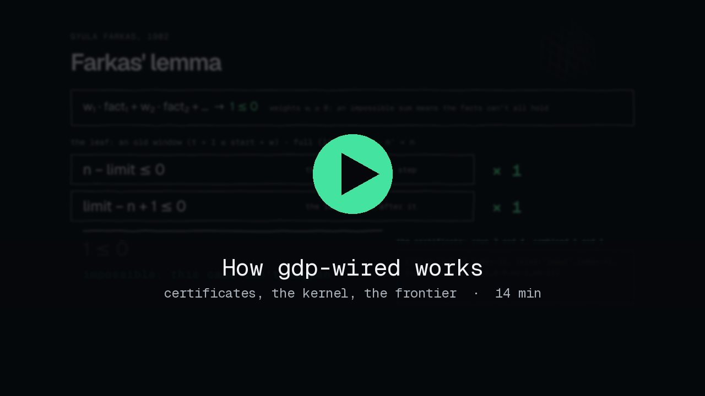
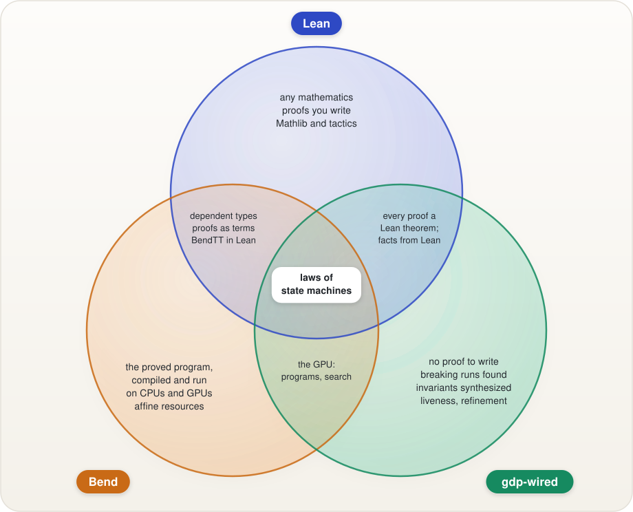

<picture>
  <source media="(prefers-color-scheme: dark)" srcset="https://raw.githubusercontent.com/monotykamary/gdp-wired/main/static/banner-dark.svg">
  
</picture>

# gdp-wired

Use gdp-wired **as a dev dependency, in tests and CI; ship plain application code**. It proves laws for stateful
rules—budgets, caps, rate limits, workflows, access policies—with no proof to write, checks proof trees in its
kernel, and can export them for Lean to check again. A false law can be refuted by a real run.

For supported TypeScript decisions, put `// gdp: law ...` comments on the plain source and check it directly:
**no duplicate model and no runtime dependency are needed**. For code outside the reader's subset, keep the model
in tests and compare it with the implementation. [The CI-only guide](docs/ci-only.md) covers direct source checks,
exhaustive finite input comparisons, mutation checks, and explicit runtime opt-in. A comparison is a test, not a proof.
Standalone record arguments must be immutable plain-data snapshots with stable own data properties: accessors
and Proxies are outside the contract, even if their TypeScript types match (see the guide's record-argument section).

If a model is intentionally used at runtime, `fun(...).run()` interprets supported terms without dynamic code generation.
`fun(...).compiled()` explicitly opts into generated JavaScript. User-supplied JavaScript helper source requires that opt-in;
arithmetic terms, library `divBy`/`modBy` helpers, and source-free `recur` equations work with the default interpreter.

[](https://gdpwired.dev/#explainer)

How it works, in 15 minutes: what a certificate is, why the kernel is small, and the frontier. [Watch it on gdpwired.dev](https://gdpwired.dev/#explainer), with captions.

```sh
npm install --save-dev gdp-wired typescript   # or bun add --dev gdp-wired typescript
```

New to formal verification? [The guide](https://gdpwired.dev/guide) takes a rule from ordinary TypeScript to a proof in
seven steps, with recipes for limits, workflows, permissions and orders with line items.

```ts
import {min, nat, proveRule, rule, when} from 'gdp-wired'

// A request of cost c is admitted while spend s is under budget b; each request is capped at m.
const budget = rule('budget')
  .params({b: nat, m: nat})
  .inputs({c: nat})
  .state({s: 0})
  .step(({b, m, c, s}) => ({s: when(s.lt(b), s.plus(min(c, m)), s)}))
const bounded = budget.law('spend stays within b + m', ({s, b, m}) => s.atMost(b.plus(m)))

proveRule(budget, [bounded]) // {proven: true, checked: true}
```

Names are typed: `({s, bb}) => …` or a law that reads the request `c` is a TypeScript error, not a runtime surprise.
Forget the cap (`s.plus(c)`) and the kernel refuses the proof; a search from the start turns it into a real run:
`{params: {b: 1, m: 0}, trace: [{c: 2}]}`. `bun examples/budget.ts` runs all of it, including the generated JavaScript,
and `examples/domains/` holds 187 rules from 21 domains (finance, access control, public services, operations,
protocols, commerce, supply chains, games, education, healthcare, energy, networking, AI agents, cloud, ad tech,
governance, insurance, bookings, safety and IoT, mobility, media), each checked three ways: the kernel proves every law
and refutes every broken variant, random runs of both runtimes agree, and Lean checks the trees.

## Security policy candidates

`gdp-wired check src/handler.ts --security --no-propose` proposes authorization, tenant
write/read isolation, workflow-order, quota and ledger laws over the extracted names.
Candidates are **not accepted policy**: review the requirement and authentication boundary,
then state the intended law with the printed `gdp: law` comment. Broken candidates are shown,
not silently discarded. Requests remain arbitrary; concurrent laws use the existing `gdp: env`
isolation model. [`research/security/README.md`](research/security/README.md) documents the
public `gdp-wired/security` templates, their limits, and the pinned public-advisory recall protocol.
The initial real-code seed set is currently refused by the readers; this is not a claim of
security-vulnerability recall or universal handler support.

## Security checks in GitHub Actions

The existing Action can opt into the same review-required security candidates as the
CLI. Install the source language's toolchain and project dependencies first, as for
ordinary stated-law checks:

```yaml
- uses: actions/checkout@v5
- uses: monotykamary/gdp-wired@main
  with:
    paths: src/handlers.ts
    security: true
    args: --no-propose
```

`security` defaults to `false`; omitted, the Action's command and behavior are unchanged.
When `true`, it adds `--security`. The CLI labels candidates **NOT accepted policy** and
prints broken candidates for review. Candidates never change the exit code or fail the
build. To enforce a reviewed requirement, state it as a `gdp: law` comment in the source:
a broken stated law exits 1, while unreadable stated laws or unsupported security
extraction exit 2. This input does not authenticate caller-supplied identities or certify
a handler secure. `args` and the optional npm `version` input continue to work as before.

Dependency-layout limitation (also present without `security`): npm-exec can omit
TypeScript from its temporary package tree when it finds TypeScript in the caller's
project, leaving the temporary `gdp-wired` unable to import it. Install `gdp-wired` and
TypeScript together in one package tree, or use the standalone `gdp-wired-cli` when that
layout occurs. The clean-workspace Action fixture does not fix or waive this limitation.

[The Action fixture workflow](.github/workflows/security-action.yml) tests the candidate
package against a temporary Git repository: default mode, review-only candidates and an
expected failing stated law. Its sources are synthetic, not upstream findings.

## First proof in your language

The rules already in your code (Python, Ruby, Elixir, Java, Kotlin, Go, Rust, Swift, C, C++, TypeScript, Effect,
XState) are read with nothing to write: the language, the class or functions, and what other code is answered or left
out are inferred.

```sh
npx gdp-wired-cli check src/limiter.py     # or .rb .ex .java .kt .go .rs .swift .c .cpp .ts (Effect, XState), a Go package, a crate, a Swift package
```

It prints the rule in the code's names, checks it against the code by running both, and proposes laws from the rule's
own comparisons, each proven, broken (with the run, as calls of your code) or unknown, with the comment that states it.
State a law with one comment over the code's names; on the line above a method it is a law of that method's step:

```python
class Limiter:
    def __init__(self, limit: int):
        self.limit, self.used = limit, 0

    # gdp: law a counted hit adds its cost: result implies used == old(used) + cost
    # gdp: law used never passes the limit: used <= limit
    def hit(self, cost: int) -> bool:
        if cost <= 0 or self.used + cost > self.limit:
            return False
        self.used += cost
        return True
```

```
limiter.py: Limiter (Python)
  checked against the code: 2154 requests from the start, 400 from drawn states, 2 from the prover's witnesses, 3 of 3 branch arms
  the entry inferred: Limiter, the class whose public methods write its state (hit; the others read it)
  names (the code's, then the rule's):
    limit         state     limit_
    used          state     used
    limit         made with limit
    hit(cost)     request   cost
    hit() result  result    hit_result
  laws stated in the code:
    proven   a counted hit adds its cost  (limiter.py:5)
    broken   used never passes the limit  (limiter.py:6)
             used <= limit
             run: made with limit = -3
                  hit(cost=-3)
  laws proposed (nothing written; state one with the comment under it):
    proven   used is never negative
             # gdp: law used is never negative: used >= 0
    ...
```

From code, the same in every language: one import, the file (a path or a URL; a Go package or a Rust crate by any file
of it), a law. The class, service or machine is inferred (`{entry}` names one), and Effect and XState run on the
packages the file's own project has:

```ts
import {extractEffect, proveRule} from 'gdp-wired/effect'     // or extractPython from 'gdp-wired/extract-py', extract, ...
const x = extractEffect('./limiter.ts')
proveRule(x.rule!, [...x.invariants ?? [], x.rule!.law('never below zero', ({tokens}) => tokens.atLeast(0))])
```

A law comment is `#` or `//` as the language has it, or an annotation (`@GdpLaw`, `@gdp_law`, `#[doc = "gdp: law ..."]`).
Its expression reads the code's own names: fields after the step, `old(x)` before it, arguments by name, `result`,
`failed`, map lookups, `forall k in m: ...`. Anything it can't read is refused with the reason, never dropped.
Modelling choices go in a `gdp.toml` beside the code. Laws about two runs (secrets, tenant isolation, migrations),
durations and business days, and citing a law to a regulation's clause are covered in
[docs/law-comments.md](docs/law-comments.md).

The exit code is 1 when a stated law is broken and 2 when one couldn't be checked, so
`uses: monotykamary/gdp-wired@main` with `paths:` runs it in CI.

For C, opt-in safety checking (`// gdp: safety`, or `--safety`) proves there is no out-of-bounds table access, signed
overflow or division by zero in the functions it covers, and replays every failure under Clang's sanitizers. It names
exactly which functions it covered and which compiler, flags and headers the proof assumes, and it refuses anything
outside that: macros that reach into system headers, aliases, function pointers, and code it can't attribute. The full
list of premises is in [docs/FRONTENDS.md](docs/FRONTENDS.md#opt-in-c-safety-stage-1).

## Where it fits



Lean proves anything you write the proof for. Bend runs programs that carry their proofs. gdp-wired proves one kind of
claim, laws about stateful rules, with no proof to write, and hands every proof to Lean as a theorem. Where a proof needs
more than it decides, the proof is Lean's: a function you define and prove there, which the rule then uses.
[`docs/comparison.md`](docs/comparison.md) goes through each region, compares the three side by side, and measures them
on the same rules.

## What it proves

All of these are proven automatically, and each proof is also a Lean theorem.
[docs/what-it-proves.md](docs/what-it-proves.md) has the details and the example behind each.

| Claim | For example |
| --- | --- |
| Invariants | spend stays within the budget |
| Laws at every key of a map, set or list | no day passes its cap |
| Step laws, and laws over up to 64 steps in a row | a balance only goes down |
| Histories: sums and queries over a log | a sliding-window rate limit |
| Statecharts, and XState machines | every state reached or shown unreachable, none stuck |
| Ordering at any distance | a refund never follows a release |
| Liveness, including under fairness | every ticket issued is served |
| Refinement | the implementation behaves like a simpler spec |
| There exists | x is even |
| Two runs side by side | the secret never changes the answer; tenants are isolated |
| Functions known by their facts, and recurrences with your lemmas | a backoff delay never passes 64 |
| Runs that never end | pagination that accepts an empty page loops forever |
| Exact rationals | a fee split in decimals |
| Recursive datatypes, records and variants | a law over every list or tree, by induction |

When the prover alone doesn't get there, it searches: it looks for the lemmas and invariants a law needs, proves them,
and hands them back as source to paste. When a law is false, it finds a real run that breaks it, and shrinks that run
until every request matters.

**What it leaves to Lean or Bend.** Proofs it would have to invent (induction that needs a lemma nobody stated and the
search doesn't find, or arithmetic with products of unknowns beyond what it decides), and shipping an arbitrary
algorithm as its proved source. The full scope is in [docs/comparison.md](docs/comparison.md#gdp-wireds-scope-in-detail).

## Why you can trust a proof

A small kernel checks every ordinary prover proof; the prover that finds them is untrusted, and the kernel's twin in Lean is proven sound.
The separate, off-by-default [`gdp-wired/lean-aggregate`](docs/lean-aggregate.md) entry returns a different verdict: **checked in Lean, not by the kernel**.

| Part | Trusted? | What it does |
| --- | --- | --- |
| `kernel/kernel.ts`, `core/check.ts` | **Yes** | Turns a rule and its laws into goals, and checks a proof tree for each: case splits on linear facts, then a linear refutation at each leaf |
| `kernel/cyclic.ts` | **Yes** | Cyclic proofs: builds each node's goals (its own, and for each node it uses, that node's hypotheses and that the rank drops) and checks each tree with kernel.ts's check. Its twin is `lean-kernel/Cyclic.lean` (`cyclic_sound`), and `lean-kernel/Bridge.lean` carries a cyclic proof of a machine's law, a recurrence's lemmas or a fold's law back to the rule itself |
| `kernel/prove.ts`, `kernel/cdcl.ts` | No | Find the proof trees: case splits, and CDCL over a goal's atoms whose refutation is unfolded into a tree. If they're wrong, the kernel rejects the tree |
| `lean-kernel/` | Optional | The kernel's twin in Lean 4.34.0, every rule proven sound there with the standard axioms only. The exporter sends the kernel's real trees; tampered ones compute to false |
| `research/search/`, `research/synth/`, `research/hw/` | No | The GPU searches for breaking runs, and invariant and rank synthesis. Every hit is replayed or proven before it counts |
| `core/dsl.ts`, `core/compose.ts`, the runtimes | No | The builders and combinators compile to the kernel's plain values; the runtimes are held to a reference evaluator |

The untrusted parts are held to the trusted ones by the test suite:

- **Builders**: every law, step law, flag, update and decision in the examples is run again on concrete runs, its
  callback's answer computed by the builders' own arithmetic (each term carries its value beside its expression) against
  what the interpreter makes of the expression that was proven (`rule.crossCheck`, `crossCheckDecision`). A builder that
  writes a different expression than it means is caught, even where the kernel would still prove the law it wrote.
- **Encodings**: `fun.compare(reference)` and `rule.compare({init, step})` run the rule against the code it describes,
  on drawn and edge inputs (strings, decimals and choices as themselves), field by field.
- **Types**: strict TypeScript and a lint that denies warnings; every switch over operations is exhaustive, so a new
  operation fails to compile wherever it's missing.
- **Conformance**: random terms through every evaluator (interpreter, generated JavaScript, the kernel, the GPU search,
  Lean's own evaluator) against the reference one.
- **Examples**: every law proven and re-checked in Lean, every rule run at random, every broken variant broken by a real
  run.
- **Tampering and mutation**: broken proofs must be rejected; every one-operator change to the kernel is run against the
  tests, and the few that survive are equivalent (`kernel/MUTANTS.md`).
- **Fuzz**: the kernel never accepts a refutation of something that has a model.

## With gdp-ts

[gdp-ts](https://github.com/rauchg/gdp-ts) makes every call site present a proof that a check ran on exactly these
values, and trusts the module that performs the check. `gdp-wired/gdp` proves that check: the trusted module hands its
private prover to a `guard` (a function's condition) or a `gate` (a rule's flag), which proves the laws when the module
loads, refuses to load if one fails, and mints a proof only where the proven condition holds. gdp-ts then holds every
call site to it: the policy is proven, every caller is held to it, and Lean checks the proof again.

```ts
// proofs/can-set-protection.ts (trusted: the only module that can mint this proof)
import {defineProof, type Named, type Proof} from '@gdp-ts/core'
import {fun, no, oneOf} from 'gdp-wired'
import {guard} from 'gdp-wired/gdp'

const canSet = fun('can set password protection')
  .inputs({role: oneOf('owner', 'member', 'viewer', 'none'), plan: oneOf('free', 'pro', 'enterprise')})
  .returns(({role, plan}) => ({allow: role.is('owner').or(role.is('member')).and(plan.is('free').not())}))
const laws = [canSet.law('the free plan never has protection', ({plan}, out) => [plan.is('free'), out.allow], () => no)]

const CanSetProtection = defineProof('CanSetProtection') // not exported
export interface CanSetProtection<U, P> extends Proof<'CanSetProtection', [U, P]> {}
const mint = guard(CanSetProtection, canSet, 'allow', {laws}) // proven here, or the module doesn't load

export async function canSetProtection<U, P>(user: Named<U, UserId>, project: Named<P, ProjectId>): Promise<CanSetProtection<U, P> | null> {
  return mint({role: await db.role(user.value, project.value), plan: await db.plan(project.value)}, user, project)
}
```

A `gate` does the same for a rule with state: each request takes the rule's step, and a proof is minted when the step
takes the flag (a one-time token redeemed, a sign-in while the account is unlocked, an email within the hourly cap).
Requests outside what was proven (a failed `assume`, a history read out of order) mint nothing and leave the state as it
was. `examples/gdp.ts` runs gdp-ts's own example this way; `@gdp-ts/core` is an optional peer dependency.

## Writing laws

A rule declares its params, the request's inputs, its state and one step. Laws are callbacks over those names, typed,
so a law that reads a name the rule doesn't have is a compile error:

```ts
import {forall, nat, bool, proveSteps, rule} from 'gdp-wired'

const caps = rule('caps')
  .params({d: nat})
  .inputs({acct: nat, day: nat, ok: bool})
  .maps({Acct: 0, Day: 0})
  .flags(({ok, acct, day, d, Acct, Day}) => ({granted: ok.and(Acct.at(acct).lt(1), Day.at(day).lt(d))}))
  .step(({acct, day, granted, Acct, Day}) => ({Acct: Acct.bump(acct, granted), Day: Day.bump(day, granted)}))

const dayCap = caps.law('day cap', ({Day, d}) => forall(k => Day.at(k).atMost(d)))
const onlyUp = caps.stepLaw('no count goes down', ({Day}, after) => forall(k => Day.at(k).atMost(after.Day.at(k))))
proveSteps(caps, [dayCap], [onlyUp]) // {proven: true, checked: true}
```

[docs/writing-laws.md](docs/writing-laws.md) covers the rest: kinds (naturals, integers, decimals, strings, choices,
optional values, records and variants), maps, sets and lists, histories, recurrences and their lemmas, liveness, pure
functions and two-run laws, loops, the Lean export and composition.

## Numbers

On Modal CPUs (2 vCPU), generated JavaScript, the answers checked against the interpreter:

| Machine | 1k | 10k | 100k | 1M |
| --- | --- | --- | --- | --- |
| Per-key caps (`research/perf/grant-scale.ts`), requests | 0.3 ms | 2.5 ms | 29 ms | 267 ms |
| Window limit, pruned (`research/perf/window-scale.ts`), events | 0.8 ms | 3.1 ms | 16 ms | 136 ms |

Pruned, the window limit holds about 35 records whatever the event count; unpruned, each request scans every record kept
(76 ms at 10k events). The interpreter copies its maps each step (it's the reference, and searches branch from it):
1.6 s for 10k requests of the caps rule.

Measured against Bend and Lean on the same three rules ([`compare/`](compare/README.md)), gdp-wired's proofs are one
or two lines and check in 25–44 ms, against 74–117 lines of hand proof and 137–161 ms in Bend and 8–30 lines and
488–571 ms in Lean. Running each tool's proved code over 100,000 requests (whole command, Modal, 2 CPUs):

| | budget | caps | window |
| --- | --- | --- | --- |
| gdp-wired | 44 ms | 59 ms | 2.6 s |
| Bend | 92 s | 75 s | over 300 s |
| Lean | 8 ms | 205 ms | 8.7 s |

The proved Bend and Lean rules keep lists and scan them; gdp-wired runs maps and a log (unpruned in this window rule).
Lean, compiled natively, wins where the state stays small. Details in [`docs/comparison.md`](docs/comparison.md).

Proving and checking: a law over 64 steps proves in about 5 s, and Lean checks its theorem in 47 s (6 s by
`native_decide`); a law over 32 steps proves in about a second. What changed since the first release, and by how much:
[`CHANGELOG.md`](CHANGELOG.md).

## Layout

| Path | What |
| --- | --- |
| `core/` | Machines, the interpreter and JS compiler, the builders, composition (`compose.ts`), the linear solver and its checker, Houdini invariants, models, the first Lean export |
| `kernel/` | The trusted kernel and the untrusted prover, with soundness fuzz (`kernel.test.ts`, `history.test.ts`) |
| `lean-kernel/` | The kernel's Lean twin, its soundness proofs, and the exported trees |
| `examples/` | The builders at work: `domains/` (187 rules across 21 domains, each with laws and broken variants), one file per feature (`budget.ts`, `liveness.ts`, `lemmas.ts`, `invoices.ts`, ...), `readme.ts` and `guide.ts` (the docs' code, kept proven), and `jev-fabric/` (a Bend project's 59 proven laws, ported) |
| `docs/` | [what-it-proves.md](docs/what-it-proves.md), [writing-laws.md](docs/writing-laws.md) and [law-comments.md](docs/law-comments.md) (the reference behind this README), [ARCHITECTURE.md](docs/ARCHITECTURE.md) (the trust boundaries and what guards each), [FRONTENDS.md](docs/FRONTENDS.md) (how a language's reader plugs in), [xstate.md](docs/xstate.md) (XState machines and model-based testing with `@xstate/graph`), [minimize.md](docs/minimize.md) (shrinking refuting runs with `minimizeRun`), [interchange.md](docs/interchange.md) (certificates as JSON, for checkers in other languages), the comparison with Bend and Lean |
| `compare/` | The same three rules in gdp-wired, Bend and plain Lean, checked and measured |
| `research/` | Everything around the library ([`research/README.md`](research/README.md)): the GPU searches (`search/`, `hw/`, `modal-gpu/`), invariant and rank synthesis (`synth/`), relational laws and guard synthesis (`next/`), bit-vector laws (`sat/`), the enumeration and benchmarks (`enum/`, `gpu/`, `perf/`), the first Lean checker (`lean/`) and the first prototype, the audit path (`audit/`) |
| `supercomputer/` | Everything above as jobs on instabox boxes through [supercomputer](https://github.com/monotykamary/supercomputer): `suite.json` is the regression suite, `setup.sh` the boxes' image |
| `scripts/` | The package build, the smoke test of the packed tarball, the Lean library generator, the diagram |
| `vendor/handwired` | [monotykamary/handwired](https://github.com/monotykamary/handwired), branch `u32-words`: Cheng Lou's Handwired with exact u32 word circuits and word stages in loop programs |
| `vendor/gdp-ts` | [rauchg/gdp-ts](https://github.com/rauchg/gdp-ts) |

The npm package is built from `core/`, `kernel/` and `lean-kernel/` alone; nothing in it imports `research/`.

## Running

The npm package is the library. Its entry points:

| Import | What |
| --- | --- |
| `gdp-wired` | The builders, `proveRule` and the other provers, `minimizeRun` |
| `gdp-wired/machine` | The runtimes: the interpreter, generated JavaScript, `search` |
| `gdp-wired/extract`, `gdp-wired/effect`, `gdp-wired/xstate` | Rules read from TypeScript, Effect services and XState machines (need `typescript`; Effect needs `effect`) |
| `gdp-wired/infer`, `gdp-wired/discover` | Invariants and lemmas nobody stated |
| `gdp-wired/compose`, `gdp-wired/minimize` | Composition; shrinking a breaking run |
| `gdp-wired/lean` | The Lean export |
| `gdp-wired/kernel`, `gdp-wired/prove`, `gdp-wired/check`, `gdp-wired/solver` | The kernel, the prover, the derivation checker and the solver |
| `gdp-wired/interchange` | Certificates as JSON; `npx -p gdp-wired gdp-wired-check cert.json` checks one with the kernel alone |

Everything else here (examples, comparisons, the Lean twin, the GPU searches) runs from a clone with
[Bun](https://bun.sh); Lean 4.34.0 for `lean/` and `lean-kernel/`, and a WebGPU runtime for the GPU parts.

```sh
git clone --recursive https://github.com/monotykamary/gdp-wired && cd gdp-wired
bun examples/budget.ts
bun test core/compile.test.ts core/runtime.test.ts kernel/history.test.ts
cd kernel && bun run-kernel.ts && bun test kernel.test.ts
```

The whole suite runs on instabox boxes through [supercomputer](https://github.com/monotykamary/supercomputer)
([`supercomputer/README.md`](supercomputer/README.md)):

```sh
supercomputer run --jobs supercomputer/suite.json --out runs/sc/suite
```

Each directory's README has its own runs and results.

Releases: bump `version` in `package.json` and push to main; `.github/workflows/publish.yml` gates it and publishes it
with npm provenance.

## The skill

Coding agents can also consult the data-only [agent-consult MCP / library](docs/agent-consult.md):
`gdp-wired-agent-consult` exposes `prove`, `why_not`, `suggest`, `check_change`, and `status`
without importing project code. Checked model proofs are not native conformance; counted accounting remains provisional.

`npx skills add monotykamary/gdp-wired` installs a skill that guides coding agents (and people) through writing a rule
the way the code does it, stating its laws, reading a refused proof and handing a claim to Lean:

- [**Workflow**](skills/gdp-wired/SKILL.md#workflow): the checklist for adding or changing a rule whose invariants matter.
- [**Writing rules**](skills/gdp-wired/references/writing-rules.md): kinds, maps, step and k-step laws, histories,
  liveness, decisions, two-run laws, loops.
- [**Reading verdicts**](skills/gdp-wired/references/reading-verdicts.md): a bug or a missing invariant, and what to
  change.
- [**Shipping**](skills/gdp-wired/references/shipping.md): running the proven rule, and holding existing code to it.
- [**The Lean handoff**](skills/gdp-wired/references/lean-handoff.md): exporting the proofs, and functions proven in Lean.
- [**Where it fits**](skills/gdp-wired/references/where-it-fits.md): gdp-wired, Lean or Bend.

## Credits

[gdp-ts](https://github.com/rauchg/gdp-ts) by Guillermo Rauch (Ghosts of Departed Proofs for TypeScript) is where the
audit path starts, and what `gdp-wired/gdp` mints proofs for; [Handwired](https://github.com/chenglou/handwired) by Cheng Lou is the circuit and GPU runtime this
builds on, through a fork; [Bend](https://github.com/bendlang/bend) is the language the laws were first written in,
and the yardstick for the benchmarks.

## License

MIT