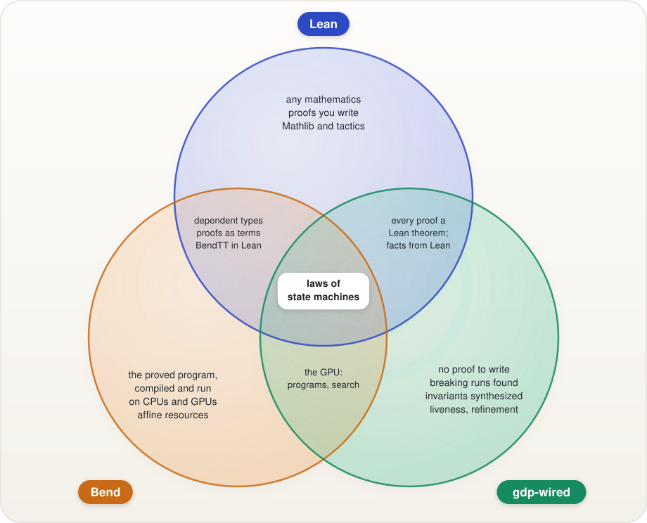

# gdp-wired, Bend and Lean

Three tools for software you can trust, built for different jobs:

- **Lean** is a general proof assistant. Anything you can state in mathematics you can prove there, if you write the
  proof (with tactics, `omega` and Mathlib to help).
- **Bend** is a programming language whose programs carry their proofs. You write the program and its proofs together,
  and the same source is compiled and run in parallel on CPUs and GPUs.
- **gdp-wired** is an automatic prover for one kind of claim: laws about stateful rules (budgets, caps, rate limits,
  workflows, permissions). You write the rule and its laws; it finds the proof itself, shows a breaking run when a law is
  false, and has every proof re-checked by Lean.

## The regions

**The center: laws of state machines over the naturals.** A spending cap, a per-key limit, a workflow's ordering. All
three can state and prove these. gdp-wired does it with no proof to write; Bend and Lean need the induction over every
sequence of requests written by hand (see the measured comparison below).

**gdp-wired only.**

- No proof to write, for everything in its fragment: invariants, laws at every key of a map, sets and ordered lists of
  names, step laws ("a balance only goes down"), laws over several steps, histories summed over time, liveness under
  fairness ("every ticket issued is served"), refinement ("this implementation behaves like that spec").
- A false law comes back as a real run that breaks it, found by searching every short history on the GPU.
- Missing invariants and loop ranks are synthesized on the GPU, then proven by the kernel.

**gdp-wired and Lean.** Every gdp-wired proof is also a Lean theorem: the exporter writes the kernel's proof trees as
Lean data, and Lean checks them against a twin of the kernel that is proven sound there (standard axioms only). When a
proof needs more than gdp-wired decides, you define the function in Lean, prove its facts there, and the rule uses the
facts.

**Bend and Lean.** Dependent types and proofs written as terms. Bend's type theory, BendTT, has its own kernel in Lean,
which proves that no checked definition has type Empty and that live code halts.

**Bend only.** The program you proved is the program that runs: Bend compiles the proved source itself and runs it in
parallel on CPUs and GPUs, with affine resource tracking.

**Bend and gdp-wired.** Both put the GPU to work, for different things: Bend runs programs on it, gdp-wired runs its
counterexample searches and invariant synthesis on it.

**Lean only.** Mathematics at large: anything with a proof you are willing to write, and the library to build it on.

## Side by side

| | gdp-wired | Bend | Lean |
| --- | --- | --- | --- |
| Invariants of a stateful rule | proven automatically | proven by hand | proven by hand (`omega` helps) |
| Laws at every key of a map, sets of names | automatic | by hand | by hand |
| Laws about one step, or several in a row | automatic (step laws, k-step laws) | by hand | by hand |
| Laws over a log of requests | automatic, given one relation | by hand | by hand |
| Liveness under fairness | automatic, and a Lean theorem over runs | no built-in notion of runs; you model them | by hand |
| One machine refining another | automatic (forward simulation), and its meaning in Lean | by hand | by hand |
| A breaking run when a law is false | yes, found on the GPU | no | no (property-testing libraries exist) |
| Synthesizing a missing invariant or rank | yes, on the GPU | no | no |
| Induction over a structure you define | through Lean: a function with proven facts | yes, written by hand | yes, written by hand |
| Shipping the proved code itself | no: the rule ships as JavaScript, held to its meaning by tests | yes, compiled and run in parallel | yes (compiled; no GPU) |
| What you trust | a small kernel (`kernel/kernel.ts`), its twin proven sound in Lean | Bend's checker, BendTT's kernel in Lean | Lean's kernel |

## Measured on the same rules

[`compare/`](../compare/README.md) writes three rules (a budget, per-key caps, a sliding-window limit) in all three
tools, checks each with its own tool on Modal, and hands each the same bug to reject:

| | Rule lines | Law lines | Proof lines | Check (median, whole command) |
| --- | --- | --- | --- | --- |
| gdp-wired | 5–7 | 1–4 | 1–2 (`proveRule`) | 25–44 ms |
| Bend 2 | 39–98 (25–50 of them proof evidence in the rule) | 5–26 | 74–117 | 137–161 ms (`--verdict` 167–178 ms) |
| Lean 4 (by hand) | 4–15 | 1–4 | 8–30 | 488–571 ms |

Most of each time is the tool's startup (17, 134 and 453 ms). gdp-wired's proofs of the same rules re-check in its Lean
twin in 1.35 s.

**Running the rules.** Each tool also runs the code it proved over the same stream of requests, and the three print the
same checksum. Whole-command medians on Modal (2 CPUs), at 100,000 requests and with no requests (each tool's startup):

| | budget | caps | window | startup |
| --- | --- | --- | --- | --- |
| gdp-wired (generated JavaScript, on bun) | 44 ms | 59 ms | 2,572 ms | 27–31 ms |
| Bend (native binary) | 92,391 ms | 75,122 ms | over 300 s | 2–3 ms |
| Lean (native, `leanc -O3`) | 8 ms | 205 ms | 8,740 ms | 4–7 ms |

What decides these is the state each rule keeps, as it was written to be proven. Bend and Lean keep lists (every grant,
every logged request) and scan them; Bend's evidence-carrying comparisons also count down one at a time, so its runs
grow quadratically or worse. gdp-wired's runtime comes from the machine: maps from key to count, and a log (this window
rule declares no pruning, so its log is scanned whole, which is where its 2.6 s goes; with `.prune` it holds about 35
records). Lean, compiled natively, starts fastest and wins where the state stays small. The full table, from 1,000
requests up, is in [`compare/README.md`](../compare/README.md#running-the-rules).

## When to use which

- **gdp-wired** for the rules around your code: limits, quotas, workflows, permissions, anything that is a state machine
  with laws. You get proofs with no proof files, breaking runs for false laws, and a Lean theorem for each proof.
- **Bend** when the program itself must be proven and you want to run that exact source, in parallel.
- **Lean** for the proofs neither of them makes: induction nobody stated, mathematics, and the facts gdp-wired needs
  about a function you define.

They compose: a gdp-wired rule can call a function defined and proven in Lean, and the Lean export takes its facts as
the hypothesis they are.

## The wall

What gdp-wired leaves to Lean or Bend is one of two things, and neither is a gap the next feature closes:

- **Proofs the prover would have to invent.** Induction over a recursive structure you define (a tree, reachability
  through a structure that changes) whose proof needs a lemma nobody stated and `discover` doesn't find; and arithmetic with products of unknowns beyond what
  products of facts and sums of squares give (the kernel takes products and squares the way Lean's `nlinarith` does,
  and the prover tries the goal multiplied by a factor first: `(Σx)² <= n·Σx²` over running samples). No automatic prover
  proves all of these: integer arithmetic with induction, or with products, is undecidable (Hilbert's tenth problem).
  Write that proof in Lean and give the rule the function with its facts. Where the structure is a recurrence on one
  natural and you can state the lemma, `recur` proves it by induction itself: the lemma is what nobody had to invent.
  Where nobody states it, `discover` looks for it among a few shapes (bounds, linear relations, a closed form of degree
  2 at most, a law between two points) and proves what it finds the same way; a lemma of another shape is still the
  wall's. An invariant nobody wrote isn't the wall: `inferLaws` looks for it among bounds, sums and differences of up to
  three values, guarded ones and laws about every key of a map, and the kernel proves the law with what it finds. A
  list compared by prefix isn't either, written as positions and a length (a prefix is then a condition about every
  position below a length).
- **An arbitrary algorithm shipped as its proved source.** gdp-wired ships the rule as JavaScript. Bend compiles the
  proved source itself.

## In one real codebase

In a codebase with 98 Bend laws and about 1,600 lines of hand proofs:

- the policy decisions, the compare-and-swap storage plans and the state and provider plans fit gdp-wired as they are
  (with names interned to numbers), and gdp-wired proves more about storage than the Bend proofs state;
- the lifecycle machine's before and after laws are step laws;
- the authority checks, built on lists of names used as sets, fit as sets of names: all ten authority laws proven
  automatically, and the rule agrees with the compiled Bend on all 7,654 outcomes over four names;
- the resource checks, which normalize scopes that are lists of paths and compare their prefixes, were written there as
  induction over nested lists. A list of paths compared by prefix needs no induction when each path is positions and a
  length: pi-fabric's path scopes, the same shape, are proven that way with no lemma (covering, attenuation through
  lists of grants, normalization both ways; `examples/scopes.ts`). This codebase's own checks haven't been ported.

In [jev-fabric](https://github.com/fabric-runtime/jev-fabric), whose four Bend proof roots state 59 laws, all 59 fit and
are proven automatically ([`examples/jev-fabric/`](../examples/jev-fabric/)): 52 as decisions about a pure function, one
as a decision about two calls (noninterference), six over runs or maps of names. The induction in its Bend proofs is
over naturals, which gdp-wired has built in, or over strings it only passes through, so nothing hits the wall; the price
is the encoding, strings interned as names and string parsing taken as the runtime's answer.

## Against Cedar

[Cedar](https://www.cedarpolicy.com) is AWS's authorization language, and the closest precedent for gdp-wired's
design: a restricted language decidable by construction, automatic analysis, a formal model in Lean, and a production
engine kept honest by differential testing against that model
([How We Built Cedar](https://arxiv.org/abs/2407.01688)). The two answer different questions.

| | Cedar | gdp-wired |
| --- | --- | --- |
| The question | Who may do what to which resource, one request at a time | Laws about rules with state: how much, how often, in what order |
| Values | 64-bit integers (overflow is an error), strings with `like`, sets, records, entity hierarchies (`in`, transitive), tags, `decimal` (4 places), `ip`, `datetime`, `duration` ([operators](https://docs.cedarpolicy.com/policies/syntax-operators.html)) | Naturals, integers and decimals (two naturals each), strings as interned names with `like` patterns and length, choices, optional values, sets of names, lists of names |
| Products | Two values may be multiplied: bounded integers keep the encoding decidable | Unbounded naturals: products as far as products of facts and sums of squares go (the wall above) |
| State and history | None: a decision reads the request, the entities and the policies | The core: invariants over every run, step and k-step laws, sums over a log, liveness, refinement, composition |
| Analysis | A policy set never errors, always or never allows, is subsumed by, equivalent to or disjoint from another ([SymCC](https://docs.rs/cedar-policy-symcc), through an SMT solver) | Laws about decisions, laws comparing two requests (`relate`), every law over every run |
| What a proof rests on | The encoding into SMT is proven sound in Lean, and the solver's answer is trusted ([SymCert](https://www.amazon.science/publications/symcert-verifying-smt-based-policy-analyses), 2026, verifies the analyses and turns models into counterexamples) | No solver to trust: a small kernel checks every proof tree, and Lean checks the same trees against a twin proven sound |
| Breaking inputs | Counterexamples from the solver's models | A breaking run, from the prover's witness or the GPU search |
| Maturity | A production Rust engine behind Amazon Verified Permissions, its Lean model and proofs open source, differential random testing run daily | Young, one author; held by its conformance tests, the builder cross-check, and ports like jev-fabric's |

So they compose rather than compete. Cedar decides the permission; gdp-wired proves the quotas, budgets, rate limits and
lifecycles around it, which Cedar leaves outside by design. A permission check can also be written as a gdp-wired
decision (attributes, choices, strings with patterns) and its laws proven, including two-request laws Cedar's analyses
don't state; what it can't take is Cedar's hierarchy: an entity graph's transitive `in` is induction, the wall again,
unless the runtime supplies membership as an input.

## gdp-wired's scope in detail

| It expresses and proves | It does not (today) |
| --- | --- |
| Step machines over naturals: scalars, maps from naturals to naturals (a write at one key, or at every key, per map per step), named step conditions, preconditions on params, assumptions per request | Lists as values in a map's cell (a list of lists is a table of nodes: below) |
| State and inputs of any kind (`.state({x: kind.from(start)})`): naturals, flags, choices, optional values, and integers and decimals with fixed places (`int`, `decimal(places)`, `.ints`, `.decimals`), as two naturals each: sums, differences, negation, multiples, comparisons, `abs`; strings (`str`): equality, Cedar-style `like` patterns declared on the kind, length, each computed from the string when it is encoded | Reals; string concatenation, substrings and regular expressions beyond globs (a computation the law doesn't read is the runtime's answer, an input) |
| Lists of names (`.lists(...)`): positions and a length, `push`, `pop`, `set`, and `insertAt`/`removeAt` that keep the order (positions shift: a write at every key reading its key at k ∸ 1 or k + 1, which the runtimes decide on breakpoints); laws about every two positions or more (`forall((i, j) => ...)`: "strictly increasing", so no name twice; `forall((i, j, k) => ...)`: "any three cells repeat a value"), and step laws that an insert puts its name in, keeps every name, and a removal takes it out (`examples/lists.ts`, a scope kept in normal form) | |
| Sets of names, as maps of 0/1 cells over names interned to numbers: a request carrying whole sets (`.carries`), conditions about every key (`everyKey`, `has`, `subsetOf`, `disjointFrom`, `sameAs`) anywhere in a step (each named as a flag of its own) and inside laws (pulled out as the law's key), the key read alone or plus or less a term and compared (`k < n`, `M[k + 1]`); conditions at every two keys or three in a step (`everyKey((i, j) => ...)`: a batch taken only when its values increase, or hold no name twice; each key read on its own, compared with the others plainly; `examples/pairs.ts`); writes at every key in one step (`each`); laws, step laws and k-step laws over them, each also a Lean theorem; a set's size over a universe of names (`within(n)`, `sizeBelow(n)`: the sum of its cells, exact for names interned below n; `examples/sizes.ts`) | A set's size over unbounded names (Lean's maps have no finite support, so no sum over every key) |
| Some key (`someKey`): "something was added, so some name is in", proven through a witness, a term naming the key, that the prover finds among the state, the params, the law's key and the request (or the one the law names) | A witness no term of the state names (which a ghost can keep: the last key added, say) |
| Functions from outside the rule (`fn`, and `divBy`, `modBy` for division and remainder by a constant): read like maps, known to the kernel only by their facts, which every goal may assume; the Lean export states the facts as the hypothesis they are, and proves them in Lean where the function has a Lean definition (`divBy` and `modBy` by `omega`); the GPU search and the GPU invariant synthesis tabulate each function over the keys they can read it at | Facts of a function not defined by a recurrence (they are Lean's to prove) |
| Functions defined by a recurrence on their first argument (`recur(name, {args, fns, zero, next}, lemmas, between)`: f(0, a..) = zero, f(x + 1, a..) = next(x, f(x, a..), a..), up to four further arguments fixed along the recursion, over the kernel's own terms and the functions in `fns`, in the start too) and what you state about them: lemmas, each a law about every x and f(x), proven by induction when the function is made (the recurrence run as a machine, the lemmas its laws, so one may lean on another and on the facts of the functions it reads), and laws between two points, about every x <= y and f(x), f(y), proven by induction on y with the lemmas; the equations, lemmas and laws are the function's facts, the runtimes compute it by the recurrence, and the Lean export defines it by the recurrence (several arguments through an injective pairing proven so in Lean) and checks the kernel's own proof of every lemma there, through the machine it was proven by and its run (`examples/lemmas.ts`); lemmas nobody stated, found (`discover(rule, laws, stepLaws)`, `gdp-wired/discover`): from the function's values, every bound, bound linear in x and in the further arguments, closed form of degree 2 at most fitted exactly, and law between two points (never shrinks, never steeper than it was) that the values meet, proven together by induction (those that aren't dropped, Houdini), and of those only what the laws need kept; the rule comes back made again with them, and they come back as source to paste into `recur` (`examples/discover.ts`) | A recursion that isn't on a natural (over a tree or a list as a value); a lemma nobody stated of another shape |
| Invariants of the state and params, laws about every key of a map; step laws relating one step's before and after (`s'`, `M'[k]`: "only increases", "stays retired"), and k-step laws about k steps in a row ("two grants on one day add two", up to 64 steps); orderings at any distance through ghost state ("a refund never follows a release": `ghost` with `ever`, `count`); liveness under fairness (`leadsTo`: "every ticket issued is served", in every run that sends each helpful request infinitely often, by a rank that drops: one natural or several compared in order; several helpful requests, each in the region where it helps; a request naming some inputs and leaving the rest, and the sets it carries, free), for machines with maps, with sets, and with a history (its queries free, within its relations); a Lean theorem over runs, and under weak fairness too (each helpful request taken whenever it stays allowed, proven allowed in its region: its free inputs at any value, or at a witness the exporter finds among 0, the state and the params, a history's query among them; the sets it carries empty) | |
| Composition: rules side by side (`product`), taking turns (`interleave`), and one rule refining another (`refinement`: a forward simulation, the spec allowing every request it is sent, steps the spec doesn't see as `stutter`, and `steps(spec, k)` where the spec takes several steps for one of the implementation's: a transfer at once refines a withdrawal then a deposit), each built as a plain machine so every law above applies; what a refinement means is a Lean theorem (`refines`: every reachable state of the implementation beside a reachable state of the spec, related by every law), for machines with maps and flags and for machines with sets (`srefines`: the sets a request carries shared by name, writes at every key, flags at every key) | Refinement where the number of spec steps depends on the state (beyond a bound k with skips) |
| Laws about one key of a map at a time, or about scalars; totals across a map's keys through a ghost total ("in use equals what the clients hold") | Sums across a map's keys other than through a ghost total |
| Histories: sums and queries over a log of requests, relations between them proven one record at a time, pruning; beside sets a request carries, conditions at every key and writes at every key, each also a Lean theorem over histories | Quantifiers over sequences other than a machine's own history |
| Decisions over facts: flags, one-of choices, optional facts, bounded naturals, records of named fields and variants (one of several cases, each with fields of its own: `record`, `variant`; `match` covers every case, a case's fields read only there), as inputs, state and results alike, and as the cells of maps and the items of lists (`.maps({M: kind.from(v)})`, `.items({L: kind})`), each their fields' variables to the kernel, the runtimes and the Lean twin (`examples/datatypes.ts`) | Reals |
| Sequences a request carries (`.carriesSeq`, and tables of them, `.carriesSeqs`): positions and a length, with prefixes, equality and extension as conditions about every position below a length (the array property fragment), so laws about prefixes of paths need no lemma; the request gives arrays of naturals; bookkeeping a request carries checked row by row (`everyBelow`) (`examples/scopes.ts`: pi-fabric's path scopes, compared with its `covers` on 20,000 random triples) | A condition about every row of a table comparing the rows' sequences (two keys at once: a row is compared at a witness) |
| Lists a request carries (`.carriesList`: an invoice's lines, each item a value of a kind, one carried map per variable of the kind and the length an input), with folds over them (each a carried map of running values whose equations every request meets: the encoding computes them, the runtimes check them) and lemmas about the folds proven by induction over the items, the folds and lemmas reading the params if they like; folds over a tree given as a value (`fold`, `proveFold`: each leaf's values from its inputs, each node's from its own and its children's, two or any number of them (`.children`, a chain of glue nodes underneath), laws by induction over the tree, Lean's `fold_sound`); trees and lists of lists in a rule's state as tables of nodes that only grow (`.nodes`: each node made from nodes already there, its folds kept with it, so a law about a subtree is a law about one node) (`examples/invoices.ts`, `examples/folds.ts`, `examples/trees.ts`); the folds' lemmas nobody stated, found the same way (`discover` for a list a request carries: bounds and relations between the folds, the length and the params; `discoverFold` for a tree: relations between its values and the params, products of a value and a param among them, and under `.children` the children's own lemmas) (`examples/discover.ts`) | A claim about a list or tree that needs a lemma nobody stated and `discover` doesn't find (prefixes of lists of paths, reachability) |
| Loops that halt by a rank or a tuple of ranks; folds over trees; progress laws ("some request makes this happen"); recursion defined in Lean, entered as a function with its facts | Induction the prover would have to invent, where no one states the lemma (the wall below) |
| Arithmetic: `+`, truncated `−`, `×` by a constant, `min`, `max`, `if`, products of two terms, a map's cell among them (a per-key quota, `Used[k] <= per·Seats[k]`), refuted with products of facts and squares (Cauchy–Schwarz, AM–GM for three, `4ab <= (a + b)²` kept by a rule), division and remainder by a constant (`divBy`, `modBy`) | Generated code for decisions alone (`compileJs` emits machines; a predicate emitter is planned) |
| k-step laws up to 64 steps, proven by a fact about each step's value first (a cut), each step's state named in the goal: 16 steps in under a second, 32 in about one, 64 in about 5, and checked by Lean (16 steps in about 3 s, 32 in about 14, 64 in about 47) (`examples/steps.ts`) | A law over more than 64 steps (an invariant and a one-step law usually say the same) |

Each "does not" above has a route already: a ghost (a witness no term names, a sum across a map's keys), a bound with
skips (spec steps that vary), an encoding (strings, datatypes as numbers a Lean function decodes), or Lean itself (a
function you define and prove there).
